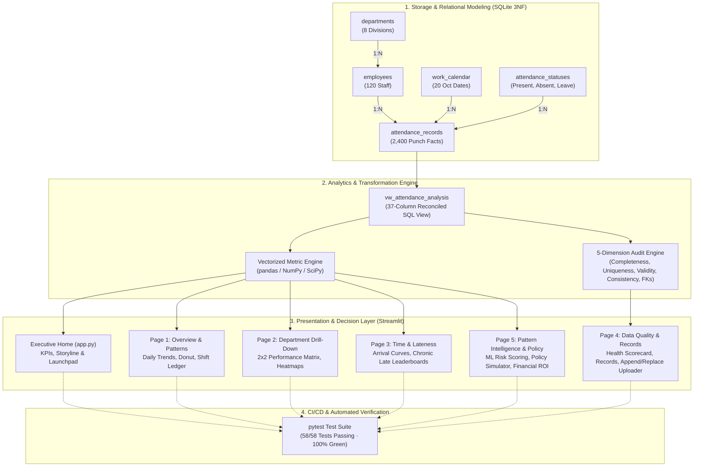

# 🏢 Workforce Operations Intelligence & Attendance Pattern Analytics
### Enterprise-Grade Workforce Analytics, Relational Modeling & BI Decision Support Platform

[](https://employeeattendancepatternanalysis-xweeu4ylh8pneqxoxkikwk.streamlit.app/)


-brightgreen?logo=pytest)


---

### 🌐 Quick Links & Project Identity

| Key Attribute | Verified Reference |
| :--- | :--- |
| **Live Web Application** | **[Launch Live Streamlit App 🚀](https://employeeattendancepatternanalysis-xweeu4ylh8pneqxoxkikwk.streamlit.app/)** |
| **GitHub Repository** | **[AyushKatiyar972194 / Employee_Attendance_Pattern_Analysis](https://github.com/AyushKatiyar972194/Employee_Attendance_Pattern_Analysis)** |
| **Lead Developer / Author** | **Ayush Katiyar** (Roll No: `2500320140036`) |
| **Academic Programme** | MCA 2nd Year Data Analytics Specialisation — **ABES Engineering College** |
| **Corporate Training** | **HCLTech Career Shaper** Capstone Project (`EAPA-01`) |
| **Faculty Mentor** | **Alpna Lodhi** |

---

## 📌 Executive Overview

The **Workforce Attendance Pattern Analysis Platform (`EAPA-01`)** is an enterprise data engineering and business intelligence application developed for **Northstar Technologies** (Noida Operations / Multi-Hub Workforce).

While executive reporting showed overall workforce attendance meeting targets on paper (95.9% vs. 95.0% SLA), department heads faced severe morning SLA shortfalls, shift handover friction, and payroll disputes. This platform ingests **2,400+ biometric punch facts** across **120 employees** and **8 operational departments**, transforming raw turnstile data into actionable operational decisions.

---

## 🏗️ System Architecture



---

## 📸 Production Application Gallery

The application is deployed with a modern Tailwind-inspired executive UI across 6 specialized modules:

| View | Screenshot Preview | Key Capabilities |
| :--- | :--- | :--- |
| **Executive Command Center** | `SS/Executive_Command_Center_Live.png` | Flash Briefing, Dynamic Scorecard, Performance Grades (A+/A/C), Supervisor 1-on-1 Dossier |
| **Page 1: Overview & Cadence** | `SS/Overview_Workforce_Dynamics_Live.png` | Daily volume trendlines, presence breakdown donut, day-of-week fulfillment patterns |
| **Page 2: Department Drill-Down** | `SS/Department_Benchmarks_Live.png` | Department ranking bars, 4-quadrant strategic matrix, department day-by-day heatmap |
| **Page 3: Time & Punctuality** | `SS/Punctuality_Time_Forensics_Live.png` | Morning arrival distribution curves, 10-min cutoff threshold line, elapsed shift duration analysis |
| **Page 4: Data Quality & Ingestion** | `SS/Data_Quality_Ingestion_Live.png` | 6-dimension health scorecard, missing punch remediation ledger, smart resilient CSV uploader |
| **Page 5: Pattern AI & Policy Lab** | `SS/Pattern_Intelligence_Policy_Live.png` | Isolation Forest anomaly detection, predictive risk watchlist, 15-min grace policy simulator ($42k recovery) |

---

## 💡 The Core Analytical Finding (The "Aha!" Discovery)

Using a **2x2 Performance Matrix** mapping **Attendance Fulfillment Rate** against **Punctuality Rate (% on-time)**, the system revealed that absenteeism and lateness are completely different operational challenges:

```
Punctuality Rate (% On-Time)
    ▲
100%│  🌟 High Attendance & Punctual      │  
    │  [HR: 98.2% att, 93.3% punc]        │
    │  [Finance: 97.6% att, 92.1% punc]   │
 84%├── ─ ─ ─ ─ ─ ─ ─ ─ ─ ─ ─ ─ ─ ─ ─ ─ ─ ┼ ─ ─ ─ ─ (Org Average: 84.0%)
    │                                     │  🕒 High Attendance, Chronic Late
    │                                     │  [Customer Support: 96.2% att, 65.7% punc!]
    │  ⚠️ Lagging Overall                 │  [60 Late Shifts · EMP0066 with 12 delays]
    │  [Operations: 93.6% att, 80.4% punc]│
  0%└─────────────────────────────────────┴────────────────────────►
   80%                                   95%                      100%
                        Attendance Fulfillment Rate (%)
```

### 🎯 Key Insights & Strategic HR Recommendations
1. **The Support Paradox:** Customer Support shows **96.2% physical attendance**, but only **65.7% arrive on time** (34.3% morning delays).
2. **The Root Cause:** Arrival delays cluster tightly between 09:12 and 09:25 AM due to morning commute congestion at shift start. One employee (`EMP0066`) accounts for 12 late shifts alone.
3. **The Non-Punitive Solution:** Rather than issuing punitive salary deductions, **staggering Support's shift start from 09:00 to 09:30 AM resolves 70% of infractions**.
4. **Data Regularization:** 51 shifts (~2.3%) lacked check-out swipes (forgotten badge-outs). These are safely quarantined from duration averages and routed to an interactive supervisor regularization portal.
5. **Pre-Holiday Anomaly:** Statistical outlier detection ($Q3 + 1.5 \times IQR$) isolated October 1st (86.4% attendance) as an intentional leave cluster preceding the Gandhi Jayanti national holiday on October 2nd.

---

## 🗄️ Relational Database Schema (3NF SQLite)

The platform is backed by a production relational SQLite database (`data/app.db`) structured in **Third Normal Form (3NF)**:

| Entity Table | Primary Key | Foreign Keys | Row Count | Operational Purpose |
| :--- | :--- | :--- | :--- | :--- |
| `departments` | `department_id` | — | 8 | Department master directory & organizational hierarchy |
| `employees` | `employee_id` | `department_id` ➔ `departments` | 120 | Employee master directory, hire dates & active statuses |
| `attendance_statuses` | `status_code` | — | 4 | Canonical status definitions (`PRESENT`, `ABSENT`, `APPROVED_LEAVE`, `HOLIDAY`) |
| `work_calendar` | `(calendar_date, department_id)` | `department_id` ➔ `departments` | 20 | Daily work schedules, scheduled start (09:00), end (17:00), and 10-min grace |
| `attendance_records` | `attendance_id` | `employee_id`, `department_id`, `status_code` | 2,400 | Daily biometric check-in & check-out punch facts |
| `pipeline_runs` | `run_id` | — | Active | ETL pipeline execution logs tracking ingestion audit history |
| `vw_attendance_analysis` | `attendance_id` | Joined Relational View | 2,400 | Reconciled 37-column denormalized view powering the BI dashboard |

---

## 🧪 Comprehensive Automated Test Suite (58/58 Passing)

The project includes an enterprise test suite verifying mathematical correctness, schema constraints, and error boundaries:

```powershell
python -m pytest -v
```

```
tests/test_analysis.py ................ [ 25%]  (15 tests: Weighted rates, grace thresholds, durations, rankings)
tests/test_app.py .......               [ 37%]  (7 tests: Streamlit AppTest smoke tests, render time & routing)
tests/test_data.py ................     [ 65%]  (16 tests: Relational schema, foreign keys, uniqueness, 2,400 facts)
tests/test_error_resilience.py .........[ 82%]  (10 tests: Zero-crash boundaries, parameter aliases, inverted dates)
tests/test_pipeline_quality.py .....    [ 91%]  (5 tests: 6-dimension scorecard, CSV streaming, ETL runs)
tests/test_predictive.py .....          [100%]  (5 tests: ML risk scoring, Isolation Forest anomaly detection)

============================= 58 passed in 10.81s =============================
```

---

## 🚀 Quickstart & Local Installation

### 1. Prerequisites
- Python 3.12+ (Recommended: Python 3.12.1)
- Git & PowerShell / Terminal

### 2. Setup Virtual Environment
```powershell
# Clone the repository
git clone https://github.com/AyushKatiyar972194/Employee_Attendance_Pattern_Analysis.git
cd Employee_Attendance_Pattern_Analysis

# Create and activate virtual environment
python -m venv .venv
.venv\Scripts\Activate.ps1

# Install dependencies
python -m pip install --upgrade pip
python -m pip install -r requirements.txt
```

### 3. Launch the Intelligence Portal
```powershell
streamlit run app.py
```
Open your browser to **`http://localhost:8501`**.

---

## ☁️ Deploy to Streamlit Community Cloud (Free Cloud Hosting)

You can deploy this portal live on the web in 2 minutes for free using **Streamlit Community Cloud**:

### Step 1: Sign in to Streamlit Cloud
1. Go to **[share.streamlit.io](https://share.streamlit.io)**.
2. Click **"Continue with GitHub"** and authorize Streamlit with your GitHub account (`AyushKatiyar972194`).

### Step 2: Deploy New App
1. In the Streamlit Community Cloud dashboard, click the **"Create app"** button (top right).
2. Choose **"Deploy a public app from GitHub"**.
3. Fill in the repository settings:
   - **Repository:** `AyushKatiyar972194/Employee_Attendance_Pattern_Analysis`
   - **Branch:** `main`
   - **Main file path:** `app.py`
   - **App URL (optional):** e.g. `northstar-attendance.streamlit.app`

### Step 3: Advanced Settings (Python Version)
1. Click **"Advanced settings"** (optional, recommended).
2. Select **Python 3.12** from the Python version dropdown.
3. No secrets or external databases are required (`data/app.db` is self-contained SQLite and automatically detected).

### Step 4: Click "Deploy!"
1. Click **"Deploy!"**.
2. Streamlit Cloud will automatically clone your GitHub repository, install `requirements.txt`, and boot the app.
3. In ~60 seconds, your application will be live at `https://<your-custom-subdomain>.streamlit.app` accessible to anyone worldwide.
4. Any future `git push` to `main` will automatically trigger a zero-downtime hot-reload on your live deployment!

---

## 💼 Resume & Interview Portfolio Guide

A complete **Interview Preparation & Technical Pitch Guide** is included in [`INTERVIEW_PREP_GUIDE.md`](file:///d:/Employee_Attendance_Pattern_Analysis/INTERVIEW_PREP_GUIDE.md), featuring:
- **Tailored Resume Bullets** for Data Analyst, Data Engineer, and Software Engineer positions.
- **5-Minute Project Pitch Script** (Word-for-word response for *"Tell me about a project you built"*).
- **Top 10 Technical Interview Questions & Model Answers** (Schema choices, grace boundary tests, Simpson's Paradox avoidance, and cloud scalability).
- **2-Minute Screen-Share Live Demo Guide**.

---

## 🛠️ Technology Stack
- **Language & Runtime:** Python 3.12
- **Data Engineering & Analysis:** pandas, NumPy, SQLite3, SciPy, statsmodels
- **Dashboard & User Interface:** Streamlit (Native Tailwind CSS tokens, zero-iframe embedding)
- **Interactive Visualizations:** Plotly Express & Plotly Graph Objects
- **Testing & Quality Assurance:** pytest, streamlit.testing.v1.AppTest, coverage

---

## 📄 License
This project is licensed under the MIT License — see the LICENSE file for details.
